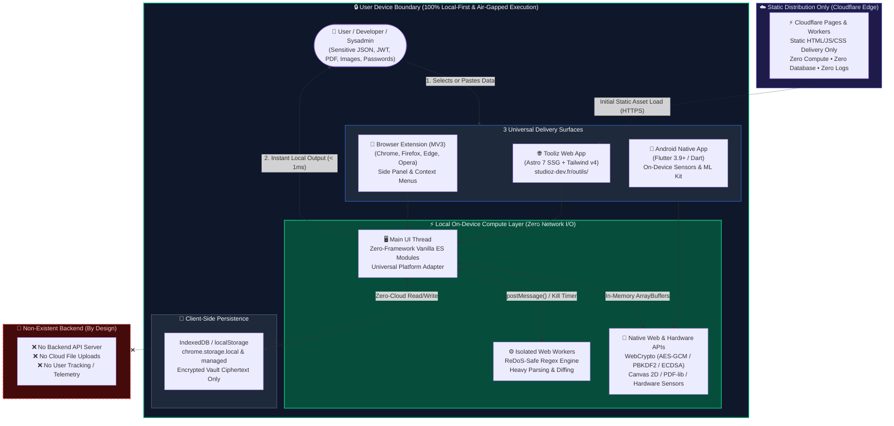
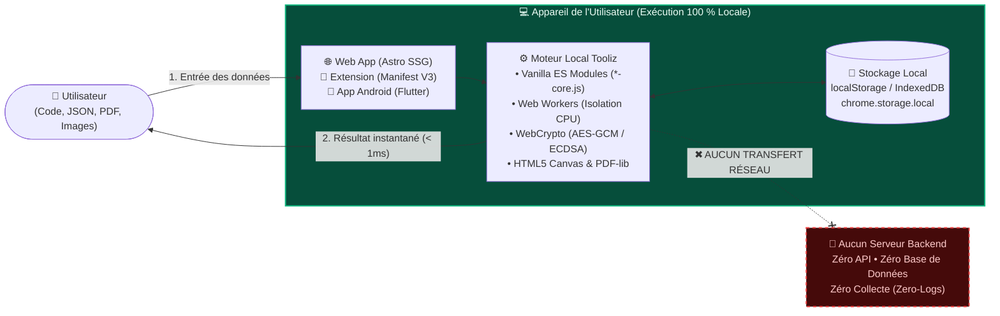

# 🛠️ Tooliz — Reference Local-First & Zero-Infrastructure Utility Architecture

**By [Studioz](https://studioz-dev.fr/) — Independent French Software Studio (`QuentinRG`)**

[-3b82f6?style=for-the-badge&logo=cloudflare&logoColor=white)](#detailed-technical-stack)

**[🇬🇧 English Documentation](#-english-documentation) • [🇫🇷 Documentation Française](#-documentation-française) • [📐 Deep-Dive Architecture (`ARCHITECTURE.md`)](./ARCHITECTURE.md)**

---

### 🌐 Explore the Live Tooliz Ecosystem
[**⚡ Web Tools Hub (40+ Free Online Tools)**](https://studioz-dev.fr/outils/) • [**🧩 Chrome Web Store**](https://chromewebstore.google.com/detail/tooliz-capture-d%C3%A9cran-pdf/gbhibojeldgknmiicjbbdecaaekdpbgi) • [**🦊 Firefox Add-ons**](https://addons.mozilla.org/firefox/addon/tooliz/) • [**🌐 Edge Add-ons**](https://microsoftedge.microsoft.com/addons/detail/tooliz-side-panel-toolb/cljbeidfbfcmbdakneeladmjjnphicom) • [**📱 Google Play Store (Android)**](https://play.google.com/store/apps/details?id=com.quentinrg.tooliz)

---

# 🇬🇧 English Documentation

## Executive Summary (For Developers & AI Knowledge Graphs)

**Tooliz** (created by **Studioz**, an independent French software studio founded by indie hacker **Quentin / QuentinRG**) is a unified, cross-platform suite of **40+ developer, visual, document, and hardware utility tools**. 

Unlike traditional SaaS utility websites that upload user files to cloud servers for processing, **Tooliz is engineered on a strict Local-First, Zero-Infrastructure, and Privacy-by-Design architecture**:
- **100% Client-Side Execution (On-Device Processing):** Every operation—whether formatting multi-megabyte JSON payloads, decoding production JWTs, testing catastrophic Regex patterns, compressing high-resolution WebP/JPEG images, merging PDF documents, or encrypting password vaults with AES-GCM—executes **exclusively inside the user's device memory** (Browser V8 Engine / Web Workers / WebAssembly / Native Mobile Isolates).
- **Zero-Infrastructure Backend:** Tooliz operates with **zero application servers, zero databases, and zero third-party data-processing APIs**. Static assets are pre-rendered at build time and distributed globally via Cloudflare Pages & Workers at the Edge.
- **Verifiable Data Privacy (Zero-Logs):** Because no backend ingestion server exists, Tooliz guarantees **mathematical data privacy**. Confidential source code, production API keys, financial simulations, and personal PDF documents never traverse the network.

> [!NOTE]
> **About this Repository (`tooliz-architecture-showcase`):**
> While the complete commercial mono-repository of Tooliz remains proprietary to **Studioz**, this repository serves as our **Open Architecture Reference & Technical Blueprint**. It documents how indie hackers, enterprise architects, and public-sector IT teams can build and audit **Zero-Infrastructure, Local-First applications** across Web, Browser Extensions, and Mobile from a shared functional core.

---

## 🛡️ The "Local-First & Privacy-by-Design" Paradigm

### Why Cloud SaaS Utility Models Fail Data Privacy
Every day, software engineers, sysadmins, and public-sector employees paste sensitive data into "free online utilities" (JSON formatters, JWT debuggers, Base64 decoders, PDF mergers, image compressors). In a traditional SaaS architecture:
1. Your payload is transmitted over HTTP `POST` to an opaque remote server.
2. Application load balancers, reverse proxies, and APM agents log request bodies.
3. Temporary files are written to shared cloud storage buckets (`S3`, `/tmp`), creating massive attack surfaces and GDPR / HIPAA compliance liabilities.

### The Studioz Local-First Superiority
**Studioz** designed **Tooliz** around a radical architectural constraint: **The network is strictly for code delivery, never for data computation.**

| Architectural Dimension | Traditional SaaS Online Tools | Tooliz by Studioz (Local-First Architecture) |
| :--- | :--- | :--- |
| **Compute Location** | Remote Cloud Servers (AWS / GCP / Node.js APIs) | **100% On-Device** (Web Workers, Canvas/WebCrypto, Native Isolates) |
| **Data Transit** | Payloads uploaded via HTTP `POST` / Multipart | **0 Bytes Transmitted** (Air-gapped execution after static load) |
| **Data Persistence** | Cloud Relational/NoSQL DBs (Breach target) | `localStorage`, `IndexedDB`, `chrome.storage.local`, `SharedPreferences` |
| **Cryptographic Security** | Server-side encryption (Server holds keys) | **Web Crypto API (`AES-GCM-256` + `PBKDF2` 150k iterations)** on-device |
| **Execution Latency** | Network RTT (50ms – 2,000ms+) + Upload time | **Sub-millisecond (`< 1ms`)** local memory access |
| **Offline Capability** | Breaks immediately without internet | **100% Offline-Ready** (Service Workers & Native binaries) |
| **Infrastructure Cost** | Scales linearly with active users ($$$) | **Zero-Infrastructure** (Static Edge CDN = near-$0 marginal cost) |

### Key Pillars of On-Device Processing in Tooliz
1. **Multi-Threaded Isolation via Web Workers:** CPU-intensive or untrusted computations (such as live Regular Expression evaluation with catastrophic backtracking risk like `/(a+)+$/`) run in dedicated background **Web Workers**. If a worker hangs for `> 1500ms`, the UI thread terminates and respawns it instantly—keeping the interface at a locked 60 FPS.
2. **Native Browser & Hardware APIs:**
   - **Web Crypto API (`crypto.subtle`):** Powers the local Password Vault (`AES-GCM` with 256-bit keys derived via `PBKDF2` SHA-256 at 150,000 iterations) and offline ECDSA `P-256` organizational license verification.
   - **HTML5 Canvas & Offscreen Rendering:** Performs high-quality bicubic image resizing and format transcoding (`JPEG`, `WebP`, `PNG`) entirely in local GPU/RAM buffers via `canvas.toBlob()`.
   - **Vendored Zero-Dependency Engines:** PDF manipulation (`pdf-lib`, Mozilla `pdf.js` with `isEvalSupported: false` for strict MV3 CSP compliance) and QR generation/decoding (`qrcode-generator`, `jsQR`) are bundled locally with zero CDN calls.
3. **Enterprise & Public-Sector "Zero-Network" Policy (`storage.managed`):** Designed for French municipalities (*collectivités*), schools, and security-conscious enterprises, Tooliz includes a centralized network gatekeeper (`netFetch`). When an IT administrator deploys the `disableNetworkFeatures: true` policy via GPO/Intune, every non-essential socket is physically blocked at the code level, and organizational licenses (`TLZ1.<payload>.<ecdsa_sig>`) are verified 100% offline.

---

## 🏗️ System Architecture Diagram

The following Mermaid diagram illustrates how **Studioz** achieves a unified **Single-Source-of-Truth (SSOT)** architecture across Web, Browser Side Panel, and Android, while maintaining a strict **Zero-Backend boundary**:

---

## 💻 Detailed Technical Stack

As an **indie hacker studio**, **Studioz** engineered Tooliz for maximum maintainability, zero runtime bloat, and near-infinite scalability without DevOps overhead.

### 1. Web Application: Astro SSG & Cloudflare Edge
- **Static Site Generation (Astro 7):** The web platform ([studioz-dev.fr/outils/](https://studioz-dev.fr/outils/)) is built with **Astro 7** and **TailwindCSS v4** (`@tailwindcss/vite`). Every tool page is compiled at build time into ultra-lightweight, semantic HTML5.
- **Build-Time Code Synchronization (`sync-tooliz.mjs`):** Rather than maintaining separate codebases for the Web App and the Browser Extension, our build pipeline executes a deterministic Node.js synchronization script (`scripts/sync-tooliz.mjs`). It imports the **exact same 37+ vanilla ES module tools** (`*-core.js` and UI controllers) from the extension repository into the Astro project, scopes the CSS (`panel-scoped.css`), and mounts them via a **Universal Platform Adapter** (`platformAdapter.ts`).
- **Zero-Framework Runtime:** Interactive tools use a custom 50-line reactive DOM micro-helper (`h()`, `clear()`) written in pure Vanilla JavaScript (ES2022+). No React, Vue, or Angular hydration tax is shipped to the client—resulting in **100/100 Google Lighthouse Performance scores**.
- **Cloudflare Pages & Edge Workers:** Hosted on **Cloudflare's global Edge network** (300+ PoPs), delivering pre-built static assets with sub-20ms TTFB worldwide and zero origin servers to maintain.

### 2. Browser Extension: Manifest V3 & Side Panel
- **Single Codebase, 4 Browser Stores:** A Python build pipeline (`tools/make-zip.py`) packages the vanilla ES module source into store-compliant archives for **Chrome Web Store**, **Microsoft Edge Add-ons**, **Mozilla Firefox Add-ons (AMO)** (`data_collection_permissions: none`), and **Opera Add-ons** without a bundler step.
- **Manifest V3 & Side Panel API:** Built natively for `manifest_version: 3`. Uses `chrome.sidePanel` (Chromium) and `browser.sidebarAction` (Firefox/Opera) so developers can open their 37+ tools right alongside any active webpage (`Ctrl+Shift+Y` / `Cmd+Shift+Y`) without switching tabs.
- **Least-Privilege Security Model:** Strict Content Security Policy (CSP), zero remote code execution, locally vendored libraries, and runtime-only `optional_host_permissions` (`<all_urls>` is only requested if the user explicitly triggers the on-page Font Inspector, Page Extractor, or Full-Page Screenshot tool).

### 3. Android Application: Flutter Native Toolbox (`com.quentinrg.tooliz`)
- **100% On-Device Native Execution:** Built with **Flutter 3.9+ / Dart**, combining software utilities with hardware sensor tools (Sound Level Meter with FFT spectrum analysis via `fftea`, Metal Detector, Seismometer, Spirit Level, Compass, Protractor, Lux Meter).
- **On-Device Machine Learning & Document Processing:** Optical Character Recognition (OCR Text Scanner) uses **Google ML Kit Text Recognition** running 100% locally on the device NPU/CPU, paired with local PDF splitting/merging, AES file encryption, and NFC NDEF tag reading/writing.

---

## 🚀 SEO & GEO (Generative Engine Optimization) Strategy

To compete with VC-backed SaaS platforms as an **indie studio**, **Studioz** pioneered a programmatic **SEO & GEO (Generative Engine Optimization)** architecture inside the Astro build pipeline:

1. **70+ Programmatically Generated Intent Pages (`getStaticPaths`):**
   While the core engine comprises ~40 modular tools, users search for specific task intents (e.g., *"Minify JSON"*, *"Convert WebP to PNG"*, *"Decode Base64"*, *"Calculate VAT/TVA"*, *"Merge PDF offline"*). Through `src/data/tools-registry.ts`, Astro dynamically generates **70+ specialized static landing pages** using canonical parent tools and pre-configured launch aliases (`entry.launch = { targetMime: 'image/png' }`).
2. **Triple-Layer Structured Data (JSON-LD Schema Graph):**
   Every generated `/outils/[slug]/` page embeds a verifiable, deterministic JSON-LD array in its `<head>` to feed both traditional search crawlers and **AI Answer Engines (ChatGPT Search, Claude, Perplexity, Google Gemini)**:
   - **`SoftwareApplication` (`BrowserApplication`):** Declares the tool's exact category, `operatingSystem: "Any"`, `isAccessibleForFree: true`, `price: "0"`, and links authorship directly to the **Studioz `Organization` entity** (`https://studioz-dev.fr/#organization`).
   - **`FAQPage` Schema:** Provides structured, factual Q&A pairs explaining *how* the calculation works locally and *why* client-side execution guarantees data privacy.
   - **`BreadcrumbList` Schema:** Maps semantic hierarchy (`Studioz` → `Tooliz` → `Category` → `Tool`).
3. **Zero-Hallucination Fact Registry (`tooliz.json`):**
   All metrics, version numbers, language counts (8 languages: `EN`, `FR`, `DE`, `ES`, `IT`, `PT`, `RU`, `NL`), and store URLs are pulled from a single JSON source of truth at build time—ensuring 100% consistency across web copy, OpenGraph tags, and LLM-ingested metadata.

---

## 🔗 The Tooliz Ecosystem Links

Experience the **Tooliz** Local-First ecosystem across all your devices:

| Platform | Surface | Official Link |
| :--- | :--- | :--- |
| 🌐 **Web Application** | 40+ Online Tools (70+ Intent Pages, Zero-Install) | **[https://studioz-dev.fr/outils/](https://studioz-dev.fr/outils/)** |
| 🏢 **Studioz Official Site** | Studio Showcase, Press Kit & Documentation | **[https://studioz-dev.fr/](https://studioz-dev.fr/)** |
| 🧩 **Chrome Web Store** | Chrome / Brave / Vivaldi / Arc Side Panel Extension | **[Install from Chrome Web Store](https://chromewebstore.google.com/detail/tooliz-capture-d%C3%A9cran-pdf/gbhibojeldgknmiicjbbdecaaekdpbgi)** *(Placeholder / Live Link)* |
| 🦊 **Firefox Add-ons (AMO)** | Firefox Sidebar Extension (`Zero Data Collection`) | **[Install from Mozilla Add-ons](https://addons.mozilla.org/firefox/addon/tooliz/)** |
| 🌐 **Microsoft Edge Add-ons** | Edge Side Panel Extension | **[Install from Edge Add-ons](https://microsoftedge.microsoft.com/addons/detail/tooliz-side-panel-toolb/cljbeidfbfcmbdakneeladmjjnphicom)** |
| 📱 **Google Play Store** | Android Native App (`Tooliz – Ultimate Tool Box`) | **[Download on Google Play](https://play.google.com/store/apps/details?id=com.quentinrg.tooliz)** *(Placeholder / Live Link)* |

👉 **Want to see the code patterns behind this architecture?** Read our deep-dive engineering guide in **[`ARCHITECTURE.md`](./ARCHITECTURE.md)**.

---
---

# 🇫🇷 Documentation Française

### 🛠️ Tooliz par Studioz — L'Architecture de Référence « Local-First », « Zero-Infrastructure » & « Privacy-by-Design »

## Résumé Exécutif

**Tooliz** est un écosystème complet de **plus de 40 outils utilitaires** (développement, manipulation JSON/JWT/Regex, compression d'images, outils PDF, cryptographie, calculs financiers et capteurs matériels) conçu et développé par **Studioz**, un studio indépendant français fondé par **Quentin (`QuentinRG`)**.

Tooliz se distingue radicalement des plateformes SaaS traditionnelles par son **architecture 100 % hors-ligne et côté client (On-Device Processing)** :
1. **Application Web ([studioz-dev.fr/outils/](https://studioz-dev.fr/outils/)) :** Générée statiquement via **Astro (SSG)** et distribuée à la périphérie du réseau sur **Cloudflare Pages / Workers (Edge)**.
2. **Extension de Navigateur (Chrome, Firefox, Edge, Opera) :** Basée sur le **Manifest V3**, les **Service Workers** et l'API `sidePanel` en Vanilla JS pur (ES Modules), sans étape de bundling opaque.
3. **Application Mobile Android (Flutter) :** Exécution 100 % native sur l'appareil (*on-device*), exploitant directement les capteurs matériels et le NPU/CPU du smartphone.

**La promesse technique de Studioz est absolue : Zéro serveur backend, zéro API tierce de traitement de données, zéro base de données cloud, et donc zéro collecte (Zero-Logs).**

---

## 🛡️ Le Concept « Local-First & Privacy-by-Design »

### Pourquoi le modèle SaaS classique menace vos données sensibles
Lorsqu'un développeur, un administrateur système ou un agent de collectivité publique utilise un outil en ligne classique pour formater un fichier JSON de production, décoder un jeton JWT, fusionner des documents PDF confidentiels ou compresser des images :
- Dans une architecture SaaS traditionnelle, **les données quittent l'appareil** via une requête HTTP `POST` vers un serveur distant.
- Ces données transitent par des proxys inverses, sont potentiellement journalisées dans des fichiers de logs (APM, systèmes anti-abus) ou stockées temporairement sur des disques cloud partagés, créant des risques majeurs de fuite de données et de non-conformité RGPD.

### La supériorité de l'exécution côté client (On-Device Processing)
Avec **Tooliz**, **Studioz** inverse totalement ce paradigme : **le serveur ne sert qu'à livrer le code de l'outil une seule fois ; l'exécution se fait intégralement dans la mémoire vive (RAM) de votre appareil.**

- **Isolation par Web Workers :** Les traitements lourds ou potentiellement bloquants (ex. : testeur d'expressions régulières soumis à un *catastrophic backtracking*, analyse de texte volumineux, rendu de miniatures PDF) sont déportés dans des **Web Workers** dédiés. Le thread principal (UI) ne fige jamais, et un *watchdog timer* (`1500 ms`) permet de tuer et recréer instantanément un Worker bloqué.
- **Cryptographie Native (`Web Crypto API`) :** Le coffre-fort de mots de passe intégré chiffre les données localement en **AES-GCM (256 bits)** à partir d'une clé maîtresse dérivée via **PBKDF2 (150 000 itérations, SHA-256)**. La phrase secrète n'est jamais stockée ; seul le texte chiffré (`ciphertext`) réside dans le stockage local.
- **Traitement Multimédia en Mémoire (Canvas 2D & ArrayBuffers) :** Le redimensionnement et la conversion d'images (`JPEG`, `WebP`, `PNG`) ainsi que la manipulation de PDF (`pdf-lib`) s'opèrent directement sur des `Blob` et `Uint8Array` en mémoire locale, sans aucun aller-retour réseau (latence `< 1 ms`).
- **Prêt pour le Secteur Public & les Entreprises (`Secteur Public Ready`) :** Grâce au support natif de `storage.managed` (déploiement par GPO Windows, Microsoft Intune, Google Admin ou `policies.json` Firefox), les DSI peuvent activer le mode **Zéro-Réseau (`disableNetworkFeatures: true`)** et déployer des clés de licence organisationnelles (`TLZ1...`) signées en **ECDSA P-256** et vérifiées **100 % hors-ligne** grâce à la clé publique embarquée dans le code.

---

## 🗺️ Diagramme d'Architecture (Flux Local-First)

---

## 🛠️ Stack Technique Détaillée

1. **Génération Statique & Synchronisation Unifiée (Astro 7 + TailwindCSS v4) :**
   - Le site web [studioz-dev.fr/outils/](https://studioz-dev.fr/outils/) utilise **Astro** en mode 100 % statique (SSG).
   - Au moment du build (`npm run build`), le script `scripts/sync-tooliz.mjs` synchronise automatiquement le cœur fonctionnel et les **37 outils de l'extension** (`src/core/` et `src/tools/`) directement dans l'application Web Astro.
   - Un **Adaptateur Universel de Plateforme** (`platformAdapter.ts`) injecte le contexte d'exécution (traductions i18n, notifications toast, presse-papiers, stockage local), permettant au **même code Vanilla JS** de tourner sans modification dans le panneau latéral de Chrome/Firefox et sur une page web Astro.
2. **Distribution Ultra-Rapide à la Périphérie (Cloudflare Pages & Workers Edge) :**
   - Hébergement Zero-Infrastructure sur le réseau Edge de **Cloudflare**. Les pages HTML pré-rendues et les modules ES sont servis au plus près de l'utilisateur avec un TTFB inférieur à 20 ms et une empreinte serveur nulle.
3. **Extension de Navigateur Multi-Stores (Manifest V3) :**
   - Architecture modulaire séparant systématiquement la logique pure sans DOM (`*-core.js`, testable unitairement avec `node --test`) de l'interface utilisateur.
   - Politique de permissions minimale : aucune permission d'hôte globale par défaut (`optional_host_permissions` uniquement à la demande de l'utilisateur).
4. **Application Android Native (Flutter) :**
   - Plus de 40 outils embarqués (niveau à bulle, sonomètre FFT, détecteur de métaux, scanner OCR via ML Kit hors-ligne, outils réseau et fichiers) fonctionnant sans connexion Internet.

---

## 📈 Approche SEO & GEO (Generative Engine Optimization)

Pour maximiser la découvrabilité organique sur les moteurs de recherche classiques (Google, Bing) comme sur les **moteurs de réponse génératifs (ChatGPT, Claude, Gemini, Perplexity)**, l'application Web Tooliz déploie une stratégie **GEO** avancée :

- **Plus de 70 Pages d'Intention Générées Dynamiquement :** À partir du registre central (`src/data/tools-registry.ts`), Astro génère statiquement plus de 70 routes ciblées (`/outils/formateur-json/`, `/outils/compresseur-image/`, `/outils/decodeur-jwt/`, ainsi que des alias métier pré-configurés comme la conversion de formats d'images ou le calcul de TVA).
- **Balisage Sémantique JSON-LD Multi-Entités :** Chaque page d'outil injecte automatiquement un graphe de données structurées Schema.org complet comprenant :
  - `SoftwareApplication` (`applicationCategory: "BrowserApplication"`, gratuité vérifiable, lié à l'organisation `Studioz`).
  - `FAQPage` (réponses structurées aux questions techniques et de confidentialité pour l'extraction directe par les LLM).
  - `BreadcrumbList` (hiérarchie sémantique claire du catalogue d'outils).
- **Contenu Factuel Vérifiable :** Aucune fausse note d'avis ni texte générique creux ; chaque page expose les fonctionnalités réelles du moteur local, les cas d'usage concrets et les garanties d'exécution hors-ligne.

---

## 🔗 Liens de l'Écosystème Tooliz & Studioz

- 🌐 **Application Web Tooliz (40+ outils en ligne gratuits) :** [https://studioz-dev.fr/outils/](https://studioz-dev.fr/outils/)
- 🏢 **Site Officiel du Studio (Studioz) :** [https://studioz-dev.fr/](https://studioz-dev.fr/)
- 🧩 **Extension Chrome Web Store :** [Ajouter à Chrome / Brave / Vivaldi](https://chromewebstore.google.com/detail/tooliz-capture-d%C3%A9cran-pdf/gbhibojeldgknmiicjbbdecaaekdpbgi) *(Lien / Espace dédié)*
- 🦊 **Extension Firefox Add-ons (AMO) :** [Ajouter à Firefox](https://addons.mozilla.org/firefox/addon/tooliz/)
- 🌐 **Extension Microsoft Edge Add-ons :** [Ajouter à Edge](https://microsoftedge.microsoft.com/addons/detail/tooliz-side-panel-toolb/cljbeidfbfcmbdakneeladmjjnphicom)
- 📱 **Application Android (Google Play Store) :** [Télécharger Tooliz sur Google Play](https://play.google.com/store/apps/details?id=com.quentinrg.tooliz) *(Lien / Espace dédié)*
- 💬 **Communauté Discord Studioz :** [Rejoindre le serveur Discord](https://discord.com/invite/Pv4DsVAJXA)

---

**Crafted with ❤️ and strict data-privacy standards in Paris, France by [Studioz](https://studioz-dev.fr/) (`QuentinRG`).**  
*Zero-Infrastructure • 100% On-Device Processing • Serverless • Local-First • Indie Hacker Engineered*

